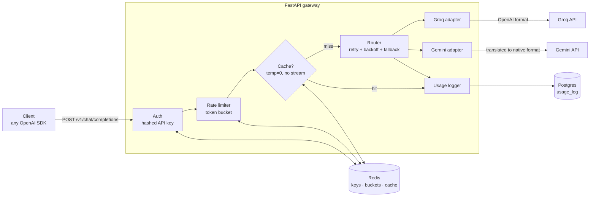

# LLM Gateway

One OpenAI-compatible API in front of Groq and Gemini. Any OpenAI SDK works by changing `base_url`.
Adds per-key API keys and rate limiting, retries with fallback across providers, an exact-match response cache,
SSE streaming, and per-request usage/cost logging.

```python
from openai import OpenAI

client = OpenAI(base_url="http://localhost:8000/v1", api_key="gw-...")
client.chat.completions.create(model="openai/gpt-oss-20b", messages=[{"role": "user", "content": "hi"}])
client.chat.completions.create(model="gemini-2.5-flash", messages=[...], stream=True)
```

## Architecture



A request goes through these steps in order:

1. **Auth.** `Authorization: Bearer gw-...` is hashed (sha256) and looked up in Redis. Raw keys are never stored.
2. **Rate limit.** A per-key token bucket (default: 20 burst, 1/s refill) runs as **one Lua script**, so concurrent
   requests can't race past the check. It returns `429` + `Retry-After` when empty.
3. **Cache.** Only for `temperature: 0` non-streaming requests. The key is the sha256 of the canonical request JSON
   (sorted keys). Results are stored with a 1-hour TTL.
4. **Router.** `gemini-*` models go to Gemini first, everything else to Groq. The retry policy depends on the error:

   | Provider error | Retry same provider? | Fall back? |
   |---|---|---|
   | 5xx / timeout / network | yes, up to 2 attempts, full-jitter backoff (cap 4s) | yes |
   | 429 rate limit | once, only if `Retry-After` ≤ 4s | yes |
   | 401 / 403 (our key is bad) | no | yes |
   | other 4xx (client's request is bad) | no | no, returned to client |

   Streams can fall back only **before the first chunk** is sent. Once bytes reach the client, a failure becomes an SSE
   error event, sent without `[DONE]`.
5. **Adapters** turn each provider's format and errors into one internal (OpenAI) format plus four gateway exception
   types, so the router never sees httpx or vendor errors. The Gemini adapter translates roles, the system prompt,
   generation config, finish reasons, thinking tokens, and Gemini's error details (`API_KEY_INVALID` arrives as a 400,
   and the 429 retry delay as `RetryInfo`).
6. **Usage log.** One Postgres row per request, including errors and cache hits: tokens, latency, provider, estimated
   cost. Rows are written after the response is sent.

Failure modes: if Redis is down, **auth fails closed** (503) but the **rate limiter and cache fail open**. A failed usage
write is logged and never fails the request.

## Running it

**With Docker**

```bash
cp .env.example .env          # add GROQ_API_KEY and/or GEMINI_API_KEY, pick a POSTGRES_PASSWORD
docker compose up --build
docker compose exec api python -m app.keys create --name me   # prints a gw-... key once
```

**Without Docker** (needs local Redis and Postgres):

```bash
python -m venv .venv && .venv/bin/pip install -e ".[dev]"
createdb llm_gateway
brew services start redis       # or: redis-server --appendonly yes
.venv/bin/python -m app.keys create --name me
.venv/bin/uvicorn app.main:app --reload
```

`PROVIDER_MODE=fake` replaces both providers with an in-process stub, which needs no API keys.

## API

| Endpoint | Description |
|---|---|
| `POST /v1/chat/completions` | OpenAI-compatible, `stream: true` supported. Response headers: `X-Provider`, `X-Cache`, `X-RateLimit-Remaining` |
| `GET /usage?days=30` | Your key's totals: requests, cache hits, errors, tokens, cost, p50/p95 latency, per-model breakdown |
| `GET /health` | Liveness check |

Errors use OpenAI's `{"error": {...}}` shape, so SDKs raise the right exception (`AuthenticationError`,
`RateLimitError`, `NotFoundError`, ...). A bad *upstream* key is returned as `502`, not `401`, because it's the gateway's
problem, not the caller's.

Key management: `python -m app.keys create --name <name> | list | revoke <key_id>`.

## Tests

```bash
.venv/bin/pytest
```

56 tests, with no network calls. Provider adapters are tested against `httpx.MockTransport`. The router is tested with
scripted providers (no real sleeping). The rate limiter and cache run against `fakeredis` with Lua support, including
a test where 50 concurrent requests hit a bucket of 20 and exactly 20 pass. API tests run the real FastAPI app wired to
these fakes.

## Load test

Measured with Locust (`loadtest/locustfile.py`) on an Apple Silicon laptop: 4 uvicorn workers, local Redis + Postgres,
100 users, 40s per run. Traffic mix: 60% unique prompts (cache miss), 30% repeated prompt (cache hit), 10% streaming.
`PROVIDER_MODE=fake` means the "model" is a stub with fixed latency, so these numbers show the **gateway's own
overhead** (auth + rate limit + cache + routing + usage logging), not Groq's or Gemini's speed.

| Simulated model latency | Request type | p50 | p95 | p99 | Failures |
|---|---|---|---|---|---|
| 0 ms (pure gateway overhead) | completion (miss) | 2 ms | 4 ms | 11 ms | 0 / 7,469 |
| 0 ms | cache hit | 2 ms | 4 ms | 12 ms | 0 / 3,721 |
| 0 ms | stream, time to first chunk | 2 ms | 3 ms | 9 ms | 0 / 1,219 |
| 200 ms | completion (miss) | 200 ms | 200 ms | 210 ms | 0 / 5,049 |
| 200 ms | cache hit | 2 ms | 4 ms | 12 ms | 0 / 2,607 |
| 200 ms | stream, time to first chunk | 22 ms | 24 ms | 31 ms | 0 / 835 |

What this shows: the gateway adds about **2 ms at p50 and about 11 ms at p99** per request. A cache hit turns a 200 ms
request into a 2 ms one. Throughput was about 320 req/s, limited by the load generator's think time (100 users, each
waiting 0.1–0.5s between requests), so this is not a maximum-throughput number.

Measured once by hand against the real APIs: Groq `gpt-oss-20b` took ~380–900 ms per completion, and the same
request served from cache took 3 ms.

## Project layout

```
app/
  main.py            routes, auth + rate-limit dependencies, SSE formatting, error → HTTP mapping
  router.py          provider choice, retry/backoff, fallback
  providers/         base.py (interface + exceptions), groq.py, gemini.py, fake.py
  ratelimit.py       token bucket Lua script
  cache.py           cache eligibility + keying
  usage.py           Postgres usage log + /usage summary
  keys.py            API key storage + CLI
  pricing.py         per-model price table (estimates; check provider pricing pages)
loadtest/locustfile.py
tests/
```

## Not done (on purpose)

Out of scope for this project: semantic caching, request queues, a dashboard, tracing. Natural next steps: a **circuit
breaker** (stop calling a provider that keeps failing, instead of retrying it on every request) and **per-key monthly
token budgets**.
